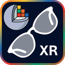

# SlicerXRGlasses



A 3D Slicer extension that shows the 3D view in stereo in XR glasses, with
optional 6DoF head tracking and live views of the glasses' cameras. Nothing is
compiled: the extension is pure Python and loads the VITURE XR Glasses SDK
from a folder you choose.

It was developed to work with **VITURE** XR glasses and, for now, supports
VITURE glasses only.

Research software. Not a medical device; do not use it for diagnosis or
treatment.

## Compatibility

| | Status |
|---|---|
| Glasses | VITURE XR glasses supported by the VITURE XR Glasses SDK. Tested with VITURE Luma Ultra (6DoF). Models without 6DoF tracking get the stereo view without head tracking or cameras. |
| macOS, Apple Silicon | Tested (Slicer 5.13 ARM64) |
| Windows x86_64 | Written for, not yet tested |
| Linux x86_64 / aarch64 | Written for, not yet tested |

VITURE is a trademark of its owner. This project is independent and is not
affiliated with or endorsed by VITURE.

## Requirements

- 3D Slicer 5.x, native build for your computer (on Apple Silicon Macs, the
  ARM64 build; the Intel build under Rosetta is not supported).
- The **VITURE XR Glasses SDK** for your platform, version 2.4.2 or newer.
  It is free to download from <https://www.viture.com/developer> and is not
  part of this repository.
- The glasses connected by USB-C, both as a display and as a USB device.

## Install

1. Download this repository and unzip it anywhere (or, once published,
   install *SlicerXRGlasses* from Slicer's Extensions Manager and skip step 3).
2. Download the VITURE XR Glasses SDK for **your** platform from
   <https://www.viture.com/developer> and unzip it anywhere. Its folder
   contains `include/` and a library folder (`aarch64/` or `x86_64/`).
3. In Slicer open *Edit → Application Settings → Modules*, add to
   *Additional module paths* the inner `XRGlasses` folder (the one that
   contains `XRGlasses.py`), and restart Slicer. The **XR Glasses** toolbar
   appears.
4. Press **Start 3D**. The first time, the **XR Glasses** module opens on
   *Glasses SDK*: select the SDK folder from step 2 (its top folder or its
   `aarch64`/`x86_64` folder). The panel confirms it, e.g. "SDK 2.4.2 ✓".
5. Press **Start 3D** again. The first load of a freshly downloaded SDK can
   take several seconds while the system checks it ("Loading the glasses
   SDK…"); later starts take about 2 seconds.

## Using it

The **XR Glasses toolbar** stays in Slicer's main window whatever module is
open:

| Control | What it does |
|---|---|
| **Start 3D / Stop 3D** | Switches the glasses to side-by-side 3D and shows the 3D view in them. Stop returns them to their previous 2D mode. |
| Status | Grey off, yellow working on it, green running, red problem. Hover it for details. |
| fps | Frames shown in the glasses in the last second; "idle" when nothing moves (nothing is redrawn then). |
| **Mirror / Head tracking** | Mirror: exactly the Slicer 3D view. Head tracking: the model also stays in place in front of you while you turn or lean; the mouse still rotates, pans and zooms it. |
| **Recenter** | Head tracking: your current head position becomes straight ahead. |
| **Depth** | Strength of the 3D effect. |
| **⚙** | Follow head position, swap eyes, black (see-through) background, all settings. |
| **✕** | Hides the toolbar. Bring it back from *View → Toolbars → XR Glasses* or from the module panel; the choice is remembered. |

Shortcuts, from any module and while wearing the glasses:

| macOS | Windows / Linux | Action |
|---|---|---|
| ⌥⌘V | Ctrl+Alt+V | Start / stop 3D |
| ⌥⌘T | Ctrl+Alt+T | Head tracking on / off |
| ⌥⌘R | Ctrl+Alt+R | Recenter |

The glasses show the 3D view as Slicer shows it, including the box, axis
labels, orientation marker and ruler. Only the background differs: it is
black by default, because black is see-through in optical glasses (untick
*Black background* to use Slicer's).

The glasses can be plugged in before or after pressing Start, and unplugged
and plugged in again while running: the extension reconnects by itself.
The toolbar follows Slicer's light or dark theme.

## Settings (XR Glasses module)

**View**
- *Mirror* or *Head tracking*, as in the toolbar.
- *Follow head position*: with head tracking, leaning or stepping moves the
  view too; untick it to follow head rotation only.

**Stereo comfort**
- *Depth* (0–3×, default 1×): strength of the 3D effect. 0 is flat; lower it
  if the image doubles or tires the eyes.
- *Viewing distance* (200–3000 mm, default 600): how far away the 3D view's
  centre of rotation appears. Objects there are the most comfortable to look
  at; larger values make the model feel further away and flatter.
- *Eye distance* (50–80 mm, default 63): the distance between your pupils.
- *Black background*, *Swap left and right eyes* (only if depth looks
  inverted).

**Cameras.** On glasses with 6DoF tracking, tick *Left grayscale* and/or
*Right grayscale* to see the tracking cameras live (about 25 fps, 640×480)
in views next to the 3D view; untick them to get the previous layout back.
They run while 3D is on. *Rotate images 180°* if they appear upside down.
The centre colour camera is not offered yet: on macOS the SDK opens it as a
webcam, which macOS only allows to applications that declare camera use,
and Slicer does not.

**Advanced**
- *Glasses 3D mode*: automatic (keeps the glasses' own resolution), or a
  fixed side-by-side resolution and refresh rate.
- *Motion prediction* (default 30 ms): compensates the display delay with
  head tracking. Too low: the model lags when you turn; too high: it
  overshoots when you stop.
- *Restore default settings* (the SDK folder is kept).

## Troubleshooting

| Status | What to do |
|---|---|
| Setup needed | Select the SDK folder in the module panel (*Glasses SDK*). |
| Connect glasses | The glasses are not seen on USB: check the cable, use a port directly on the computer, not a hub. On Linux check the udev rule below. |
| The glasses did not accept 3D mode | Press the 2D/3D button on the glasses. |

- **macOS, "Allow this SDK"**: shown when macOS blocks an SDK downloaded with
  a browser. It removes the download quarantine from the SDK library folder
  only.
- **Linux, glasses not found**: allow the glasses without root, then unplug
  and re-plug them:

  ```bash
  sudo tee /etc/udev/rules.d/70-xr-glasses.rules <<'RULES'
  SUBSYSTEM=="usb", ACTION=="add", ATTRS{idVendor}=="35ca", MODE="0660", TAG+="uaccess"
  SUBSYSTEM=="hidraw", KERNEL=="hidraw[0-9]*", ATTRS{idVendor}=="35ca", MODE="0660", TAG+="uaccess"
  RULES
  sudo udevadm control --reload-rules && sudo udevadm trigger
  ```

- **Linux with Wayland**: Wayland may not let the application place its
  window on the glasses' display; use an X11 session if the 3D window does
  not appear on the glasses.
- **Changing the SDK folder** takes effect after restarting Slicer.

## How it works

```
glasses ─USB─ VITURE SDK (C library) ─ctypes─ device.py ─┐
                                                         ├─ session.py ─ toolbar / module panel
display ◀── frameless window: left eye view | right eye view
```

- `XRGlassesLib/sdk.py`: finds the SDK library for this platform in the
  selected folder (`libglasses.dylib`, `glasses.dll` or `libglasses.so`),
  checks its version and declares the C functions.
- `XRGlassesLib/usb.py`: lists USB devices with each platform's own API
  (IOKit, SetupAPI, sysfs) to see whether the glasses are plugged in.
- `XRGlassesLib/device.py`: a background thread that starts the SDK when the
  glasses appear and shuts it down cleanly when they are unplugged; it also
  receives the camera frames.
- `XRGlassesLib/session.py`: the stereo window (one Slicer 3D view per eye,
  side by side on the glasses' display), the 3D display-mode switch, and the
  update loop that keeps both eyes in step with the main 3D view and the
  head pose. Nothing is re-rendered while neither moves.
- `XRGlassesLib/cameras.py`: live camera views (volume nodes updated from
  the camera frames, shown in a layout next to the 3D view).
- `XRGlassesLib/stereo_math.py`: eye camera geometry. The 3D view's centre
  of rotation is the zero-parallax plane at a fixed apparent distance; eye
  separation and head translation scale with the scene.
- `XRGlassesLib/displays.py`, `macdisplay.py`: find the glasses' display on
  each platform; on macOS, keep it on the desktop in 3D mode.
- `XRGlassesLib/toolbar.py`, `XRGlasses.py`: the toolbar and the module
  panel.

## Tests

```bash
python3 XRGlasses/Testing/test_stereo_math.py
```

In Slicer, with *Developer mode* on (*Application Settings → Developer*),
*Reload and Test* in the module runs the geometry tests, checks the toolbar
and the USB listing and, with an SDK selected and glasses connected, two
start/stop cycles. **It clears the scene: save your work first.**

## Authors

**Developers**
- Domenico Riggio ([@DomenicoRiggio](https://github.com/DomenicoRiggio))
- Steve Pieper ([@pieper](https://github.com/pieper))
- Edoardo De Rose ([@edoardoedr](https://github.com/edoardoedr))

**Credits**

Thanks to Ron Kikinis, Steve Pieper and Maria Francesca Spadea for their
supervision and support.

## License

To be decided by the authors before the first public release. The VITURE
SDK is not included and is governed by VITURE's own terms.
